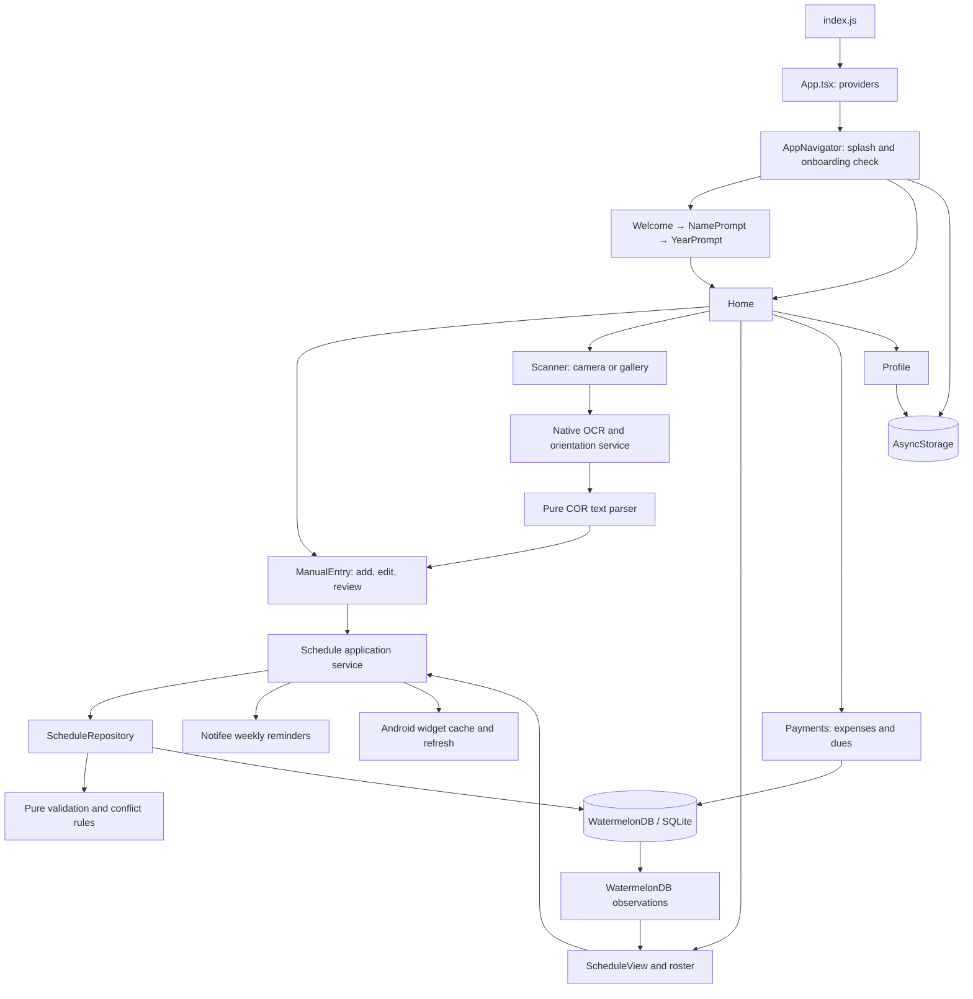

# Architecture and application flow

## Runtime overview

Trakn is a local-first React Native application using React 18, React Native 0.76, React Navigation native stacks, and TypeScript. There is no application server, authentication provider, remote API, or synchronization backend in this repository.

## Startup and onboarding

1. `index.js` registers the React Native application, the Notifee background event handler, and the Android widget task handler. The notification handler currently logs an action; it does not navigate to a class.
2. `App.tsx` supplies safe-area and navigation contexts.
3. `AppNavigator` reads `@user_name` and `@user_year` while displaying the splash screen. Both present means Home; name only resumes YearPrompt; otherwise it opens Welcome. A storage read error falls back to Welcome.
4. NamePrompt and YearPrompt save values to AsyncStorage. Completing onboarding resets the navigation stack to Home.
5. Home loads the saved name on focus. Once per Home mount it removes empty schedule records and refreshes reminders and the widget from current persisted data.

`src/navigation/types.ts` defines the stack's route contract. Manual entry and the scanner use typed screen props, including the extracted-subject review queue. Older screens still have some `any` navigation props.

## Schedule reads and writes

Manual entry handles form state, keyboard behavior, scanned-subject review, feedback, and navigation. Reads go through `scheduleRepository`. Mutations go through `scheduleService`:

1. Validate the subject's required fields, units, and logistics. All logistics may be blank for TBA; partial logistics are rejected. End time must follow start time.
2. Enter a WatermelonDB writer and fetch the current destination term and its subjects. Exclude the subject being edited from conflict and unit totals.
3. Check overlaps on shared days. Adjacent times are allowed. Enforce the term maximum (24 units, or 6 in summer) and any declared unit limit against persisted totals.
4. Resolve relationships, then prepare the parent and child changes. A move also removes the source term if its last subject is leaving. Commit all prepared changes in one batch.
5. After the writer completes, refresh reminders and the Android widget. Refreshes are serialized to prevent an older refresh finishing after a newer refresh.
6. Persistence errors propagate to the screen, which retains the form and displays an error. A committed save with an integration failure returns `syncIssues`; the screen reports that the subject was saved and identifies the integration that failed. The form blocks repeated save taps while a save is pending.

Deleting a subject removes its parent when it becomes empty. Deleting a schedule fetches its current children inside the writer and deletes the parent and children together; it does not rely on a potentially stale rendered roster. Both deletion paths refresh integrations, including canceling alarms when no subjects remain.

Read-only reactive UI bindings can query WatermelonDB directly. New schedule mutations should go through the service; calling the repository directly intentionally does not trigger native integrations. The repository accepts a `Database` in its constructor, so it can be tested without loading native SQLite.

## OCR import

`ScannerScreen` checks the latest schedule's scan restriction, launches the camera/gallery crop picker, and owns preview and processing UI. It delegates rotation and text recognition to `features/scanner/services/recognizeSchedule.ts`.

The recognition service tries the preferred image orientation first and may try the other quarter turns. The pure parser in `features/scanner/domain/corParser.ts` normalizes OCR text, identifies the semester and academic year, groups course codes with nearby title/unit/room/schedule lines, and returns typed subject drafts. A document plausibility check looks for academic evidence; it is a heuristic, not proof of document authenticity.

The scanner replaces its route with ManualEntry and supplies the extracted queue. Each draft is reviewed and saved individually through the same path as manual entry. This is not an atomic whole-document import: already saved subjects remain if the user leaves halfway through review. Bare-hour ranges such as `8am - 9am` normalize to `08:00 AM` and `09:00 AM`.

## Payments and budget analysis

The Payments hero card opens budget settings. The former header settings button has been removed. The settings sheet supports daily, weekly, and monthly budgets and an optional reserve for unpaid academic fees. The selected amount is the full budget for that period; selecting a different period does not automatically scale the amount.

`features/finance/domain/budgetAnalysis.ts` computes current-period spending, the remaining budget, unpaid fees, today's allowance, category shares, average daily spending, and an estimated period total at the current pace. Calculations use local calendar boundaries:

- Daily: local midnight to the next midnight.
- Weekly: Monday midnight to the following Monday, including Sunday as the last day.
- Monthly: the first day of the calendar month to the first day of the next month, including leap years.

Only recorded expenses within the selected current period and no later than the current time contribute to its totals. The default activity list follows that period; "View all" shows older records without adding them to the current budget calculation. Dates and times are displayed on transactions. Category breakdowns use the same filtered records, grouping unknown legacy categories under Others.

Today's allowance is the nonnegative, rounded-down share of `(budget − period spending − optional unpaid-fee reserve)` across the remaining calendar days, including today. Monetary sums use cents. Insights distinguish expenses exceeding the budget, an unpaid-fee reserve exceeding available funds, and projected overspending. Projections use elapsed calendar days and are labeled estimates; they are not forecasts based on historical models. An empty expense log is described factually.

Unpaid fees have no due dates in the current schema, so the reserve includes **all** unpaid academic fees. It is off by default to preserve the previous allowance behavior. Marking a fee paid updates the checklist and releases its reserve; it does not create an expense. The screen explains that users should log actual payments as Academic expenses. This keeps the existing checklist semantics and avoids automatically duplicating payments that were already logged.

`features/finance/data/budgetStore.ts` stores amount, period and reserve preference together in the versioned AsyncStorage key `@budget_settings`. Existing `@budget` amounts load as weekly budgets without deleting the old key. Invalid settings fall back to a valid legacy budget or the default. Settings update the UI only after storage succeeds.

`FinanceRepository` owns expense and fee mutations. The screen keeps forms open on failure and blocks duplicate submissions until persistence and sheet dismissal finish. Expense and due observations include relevant columns, so toggling a paid fee recalculates the reserve immediately. A finance date hook refreshes the period at local midnight and when the app returns to the foreground.

`BudgetCard` shows one daily allowance, a spending progress bar, the amount spent and time left. It omits the repeated budget/remaining-balance tiles. Neutral insights are hidden; warning copy is brief. `SpendingBreakdown` is collapsed until opened. The settings sheet uses brief labels and keeps accounting details behind the academic-dues info button.

Academic dues appear immediately beneath the allowance as a prioritized card queue. Drag a handle to lift a card immediately and drop it higher or lower; the first unpaid card is labeled "Next". Long queues scroll within the board, with edge scrolling while dragging. The main page pauses scrolling during a drag. Paid cards are folded into a separate section. Screen-reader actions offer the same priority moves. A cancelled gesture or a change to the pending records cancels the drop.

`useDueDrag` keeps pointer movement in stable Animated values and updates React state only when crossing a priority slot. Neighboring cards slide into the live gap with native-driven transforms; lift and drop animations use the same native values. Animation destinations are cached to avoid restarting unchanged transitions. Edge scrolling uses animation frames only near an edge, with speed based on proximity, rather than a continuously running interval. The release handler uses the final touch coordinates for fast drops. Reverted storage changes also restore a settling card's visual position.

The academic-dues info button opens `DuesInfo` inside the shared animated Payments sheet. It uses the same cream background, rounded corners, maroon action button and gold icon accents as the other sheets; it does not use a system alert.

The priority hook optimistically reorders cards and saves their IDs in AsyncStorage under `@academic_due_priority`; no database schema change is needed. It restores the previous order and alerts on a failed write. Saved priorities ignore deleted records, and unranked/new fees append to the queue. Marking a fee paid removes it from the pending lane; it still follows the existing checklist/payment accounting rules. Priority controls wait for stored preferences to load and prevent overlapping writes.

Finance tests cover calendar boundaries, future/historical record exclusion, cent precision, reserve toggles, persistence compatibility, repository operations, card interaction, period changes, history visibility, failed saves, drag/drop and cancellation, accessible priority moves and priority-write recovery. Components retain the maroon, cream and gold palette and rounded-card styling.

## Storage model

| Store | Fields and purpose |
| --- | --- |
| `schedules` | Academic term, declared unit target, creation date |
| `subjects` | Parent schedule ID, code, section, title, units, room, instructor, JSON days, start/end time, creation date |
| `expenses` | Title, amount, category, icon, creation date |
| `dues` | Title, amount, paid status, creation date |
| AsyncStorage | Profile fields, budget setting, Android widget cache |

`Schedule.subjects` is a typed `Query<Subject>`. `Subject.schedule` is a typed `Relation<Schedule>`. The stored `days` string is converted by a JSON decorator. Invalid JSON values are sanitized to an array of strings. Time values remain strings such as `08:00 AM`; blank time and day fields represent TBA.

The legacy column/property `total_subjects` / `totalSubjects` actually stores **declared total units**, not a subject count. The feature API calls it `declaredUnits`; do not repurpose the database column without a migration. Actual subject counts come from related records.

Only `created_at` exists on schedules. The previous model also declared `updated_at`, which was absent from the schema; that decorator has been removed. The Home card now labels its creation timestamp as "Added". A real modification date requires a schema migration and updates on every child mutation.

`src/tokens/` is the authoritative design-token source. `src/shared/tokens/` re-exports it to preserve existing imports. The Home and manual-entry toast animations share a hook that cleans up timers and animations on unmount.

## Reminders and widgets

Both integrations use the most recently created schedule as the active term, following the widget's existing policy. Reminders cancel existing notifications and create weekly alerts 15 minutes before each scheduled class. No permission prompt is needed to clear an empty schedule. Invalid/TBA times are skipped. Notification permission and scheduling errors do not turn a committed database save into an apparent failed save.

Widget synchronization runs only on Android. It saves today's classes to `@widget_schedule_cache` and requests an immediate redraw. The background task reads that cache on widget add/update/resize. Widget clicks open the native `trakn://home` deep link. There is no React Navigation linking configuration that routes the add button directly to ManualEntry.

## Verification and practical limits

Run `npm run typecheck`, `npm test -- --runInBand`, and `npm run lint` from the project directory. The app-shell smoke test deliberately mocks navigation and native-feature loading. Repository tests use real WatermelonDB models and queries with its in-memory LokiJS adapter; they exercise relations, concurrent writes, conflicts, unit limits, updates, moves, cascading deletion, and failure propagation. Service and reminder tests stub native boundaries.

The current dependency set pins ESLint 8.19.0, but the installed TypeScript ESLint plugin requires `^8.56.0`. Linting fails during configuration loading (`jest/globals` is unknown; loading its plugin also encounters an unsupported ESLint API). Align the ESLint version and lockfile before treating lint as a working check. An attempted compatible update could not resolve the package metadata in this environment; no dependency versions were changed.

Passing JavaScript tests does not establish native SQLite transaction behavior, notification delivery under device power policies, camera permissions, OCR accuracy, or widget rendering. Device verification should include save/edit/delete, a denied notification permission, camera and gallery imports, and an installed widget, followed by an iOS native smoke check on macOS.

## Remaining maintenance priorities

These are existing limitations identified during the review, not completed changes:

1. **Migration coverage:** the schema is version 2 but the SQLite adapter has no migration history. Merely increasing a schema version is not a data-preserving upgrade strategy. Recover the released version-1 schema, add explicit migrations, and test upgrades before changing persisted fields.
2. **Term identity and active state:** manual entry normalizes a scanned term to `1st Sem`, `2nd Sem`, or `Summer`, losing the year. There is no `isActive` or archived flag; Home treats older records as archived, and archived cards still open the latest roster. The agenda queries all subjects, while reminders and widgets use the latest term. Introduce explicit year/term identity and schedule IDs in navigation together, with migration and selection tests.
3. **Finance growth:** finance rules, period totals and mutations now have feature boundaries and regression coverage. Future additions such as dated dues, paid-fee transaction links, custom-length budget cycles or separate budgets per period need explicit product semantics and, where applicable, schema migrations. The current screen still observes the complete expense history; move large histories to paginated queries if usage warrants it.
4. **Widget rollover:** only today's formatted rows are cached. A background refresh on another day can display yesterday's rows under today's date until the app synchronizes again. Cache a dated/full-week snapshot and test background selection without requiring the app to open.
5. **OCR ambiguity:** the parser uses proximity and code patterns, not table geometry. A room such as `MAC101` can resemble a course code. Add representative, anonymized OCR fixtures and contextual row classification before relaxing the parser heuristics. Review remains necessary.
6. **Profile and onboarding storage:** keys and defaults are duplicated between screens. Onboarding currently advances even when a storage write fails. Extract a profile store and test incomplete setup, read failures, and write failures.
7. **Screen decomposition:** the manual-entry form, timetable action sheet, finance modals, and profile pickers remain substantial UI components. Extract cohesive components and form hooks incrementally after their data boundaries are covered.
8. **Campus map:** `CampusMapModal` currently renders a coming-soon message. Its room lookup and the building constants are scaffolding, not a functioning map.

Keep subsequent work scoped by feature. Add tests around the behavior being moved, establish a data/service boundary, then split the UI. Database migrations and product changes such as active-term selection should be separate, reviewable changes.
