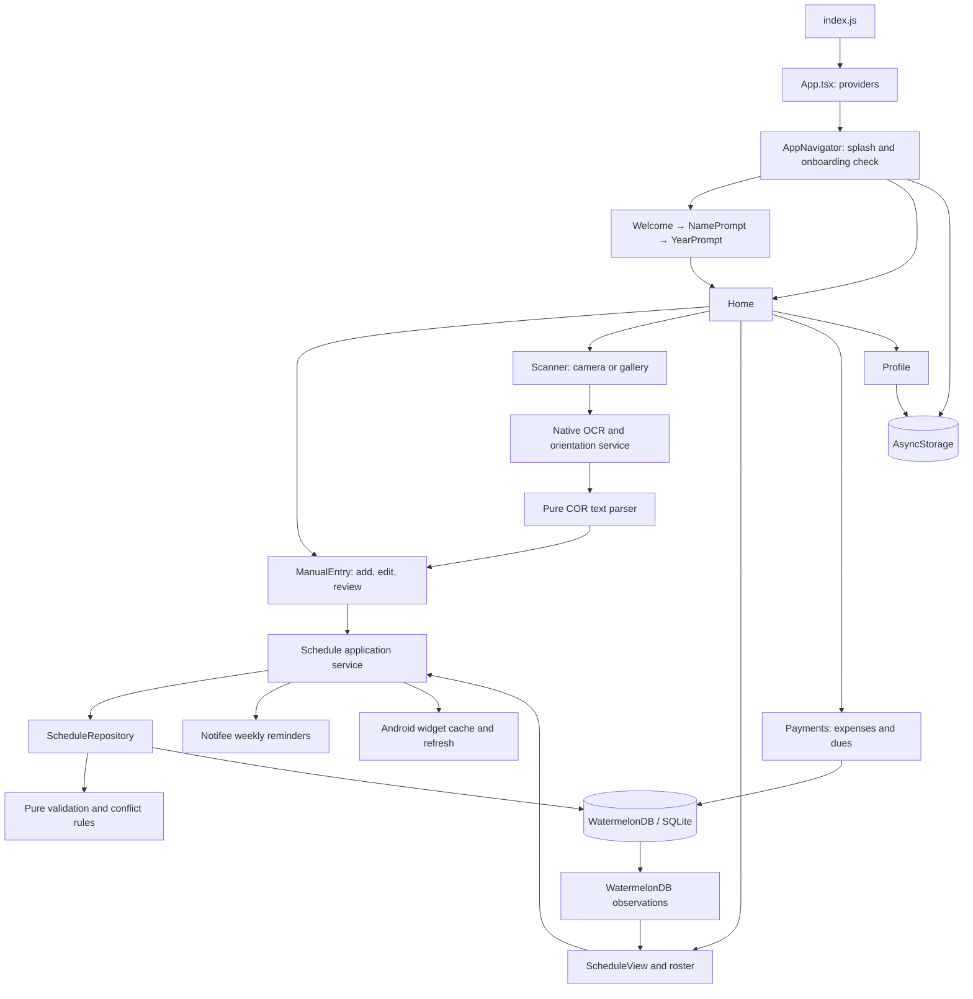

# Architecture and application flow

## Runtime overview

Trakn is a local-first React Native application using React 18, React Native 0.76, React Navigation native stacks, and TypeScript. There is no application server, authentication provider, remote API, or synchronization backend in this repository.

## Startup and onboarding

1. `index.js` registers the React Native application, the Notifee background event handler, and the Android widget task handler. Notification presses queue a validated schedule/payment destination for navigation after startup.
2. `App.tsx` supplies safe-area and navigation contexts, consumes notification taps, and refreshes budget alerts on launch and foreground return.
3. `AppNavigator` reads `@user_name` and `@user_year` while displaying the splash screen. Both present means Home; name only resumes YearPrompt; otherwise it opens Welcome. A storage read error falls back to Welcome.
4. NamePrompt and YearPrompt save values to AsyncStorage. Completing onboarding resets the navigation stack to Home.
5. Home loads the saved name on focus. Once per Home mount it removes empty schedule records and refreshes reminders and the widget from current persisted data.

`src/navigation/types.ts` defines the stack's route contract. Manual entry and the scanner use typed screen props, including the extracted-subject review queue. Older screens still have some `any` navigation props.

## Schedule reads and writes

Manual entry handles form state, keyboard behavior, scanned-subject review, feedback, and navigation. Reads go through `scheduleRepository`. Mutations go through `scheduleService`:

1. Validate the subject's required fields, units, and logistics. All logistics may be blank for TBA; partial logistics are rejected. End time must follow start time.
2. Enter a WatermelonDB writer and fetch the current destination term and its subjects. Exclude the subject being edited from conflict and unit totals.
3. Check overlaps on shared days. Adjacent times are allowed. Enforce the term maximum (24 units, or 6 in summer) and any declared unit limit against persisted totals.
4. Resolve relationships, then prepare the parent and child changes, parent modification timestamp, and activity snapshot. A move also updates the source term's timestamp or removes that term when its last subject leaves. Commit all prepared changes in one batch. Unchanged saves do not create timestamps or activity.
5. After the writer completes, refresh reminders and the Android widget. Refreshes are serialized to prevent an older refresh finishing after a newer refresh.
6. Persistence errors propagate to the screen, which retains the form and displays an error. A committed save with an integration failure returns `syncIssues`; the screen reports that the subject was saved and identifies the integration that failed. The form blocks repeated save taps while a save is pending.

Deleting a subject updates its parent's timestamp or removes the parent when it becomes empty. Deleting a schedule fetches its current children inside the writer and deletes the parent and children together; it does not rely on a potentially stale rendered roster. Removal activity remains as a small snapshot. Both deletion paths refresh integrations, including canceling alarms when no subjects remain.

`RecentOverview` observes only the latest schedule, its displayed subject fields, and the latest four activity snapshots. It shows a plain update timestamp with a View schedule link, the ongoing/next valid class (including Sunday), and activity. Subject/unit totals are available in the roster instead of a duplicate summary card. Existing subjects supply their actual creation events when no activity history exists. `useVisibleNow` refreshes relative timestamps and class status at minute boundaries, on focus, and on foreground return; it stops timers when hidden. The timetable observes only the latest term and memoizes subject projections. Archived cards pass their schedule ID to the roster instead of opening the latest term.

Read-only reactive UI bindings can query WatermelonDB directly. New schedule mutations should go through the service; calling the repository directly intentionally does not trigger native integrations. The repository accepts a `Database` in its constructor, so it can be tested without loading native SQLite.

Manual time entry uses `maskClockInput` and `parseClockField`: four digits (`0800`) become `08:00`, extra digits are bounded, and incomplete or invalid hours/minutes block saving. AM/PM stays visible; a same-day range infers PM when a morning start crosses noon (`11:00` to `01:00`), while ordinary morning ranges remain AM. Explicit user, scanned, and saved periods take precedence. Unambiguous 24-hour values normalize to 12-hour display. Field errors and the full day/time range gate saving; equal-time, reversed, out-of-range and partial entries are rejected. The repository validates independently and checks conflicts against persisted subjects. Sunday is selectable and appears in both the daily agenda and weekly timetable. Zero declared units cannot trigger the completed-schedule screen.

Manual entry uses a direct 1–6 subject-unit selector with 44-point minimum touch targets and wrapping on narrow screens. The enrolled-unit target remains a numeric field with the term maximum beside it. A completed numeric entry dismisses the keyboard only when the whole form is valid; loading scanned values and editing a title do not trigger dismissal. Done on a completed TBA title also reveals the save controls. Android relies on the activity's `adjustResize` instead of a second keyboard height adjustment. Term reads ignore stale results and a failed summary load offers a retry while saving stays disabled.

Home remounts its scroll container when changing tabs and resets the floating action button's scroll animation, so a new tab starts at its top. Payments uses a single virtualized list for expense history, with the budget, dues board and quick actions as its header. It renders an initial eight transactions rather than mounting the entire history. The finance midnight timer stops while the app is in the background and refreshes on return.

Startup routes immediately after the two profile storage reads complete, without the previous forced 1.5-second wait. The existing 400 ms splash fade remains, and async startup callbacks stop updating state after unmount.

Archive is a live saved-schedule library, including the only/current semester instead of hiding it. The latest nonempty schedule is marked Current; previous semesters appear beneath it. `features/schedule/data/archive.ts` combines one schedule observation and one subject observation to derive actual subject counts and units, without queries per card. Edits, grade updates, additions, moves and deletions update the displayed records; each card opens its own schedule ID. Empty database records are omitted. This does not introduce an archive flag or change which schedule drives reminders and widgets.

New-entry sessions allow choosing another semester even when a saved term is complete. Camera and gallery use the same manual-entry review form, including the direct unit selector, numeric keyboard completion, save feedback and optional enrolled-unit target. Students may correct the detected semester before the first queued subject is saved; it then stays fixed across that queue. Entered targets are validated, while missing scan targets remain optional because a cropped image may contain only part of a COR.

## Grade log and calculation

The Home Grades tab lists entered subjects by stored schedule ID. Grades are selected from `1.00`, `1.25`, `1.50`, `1.75`, `2.00`, `2.25`, `2.50`, `2.75`, `3.00`, and `5.00`; missing grades remain null. Grade selection autosaves through `GradeRepository`, batching the subject grade, parent modification timestamp, and activity snapshot. Grade-only edits do not reschedule reminders or widgets. Ordinary schedule edits preserve existing grades. Failed commits restore the prepared cache snapshots so retrying the same grade still writes it.

The Home floating-menu container uses `pointerEvents="box-none"`: its invisible closed-menu area must not intercept grade-row taps underneath. The content scroll view handles the first tap when a keyboard is present. Payments and the grade picker share `shared/animations/bottomSheet.ts`: a 250 ms backdrop fade with a spring from 600 points (tension 65, friction 9), followed by a 200 ms fade/slide on dismissal. Both use native-driver animations in a hardware-accelerated modal without a second native window animation. The grade picker retains content until exit finishes, blocks selection during dismissal, cancels stale exit callbacks when reopened, and skips motion when Reduce Motion is enabled. A synchronous write guard blocks queued close/open/select events during a pending save and releases on both success and failure; regression checks cover repeated opening, interrupted dismissal, save retries, and taps during entry.

`features/grades/domain/gpa.ts` calculates `sum(grade × units) / sum(units)`, including failing grades. Every entered subject must have a supported grade and a positive finite unit weight before the semester's Calculate GPA button enables. A subject grade is not defaulted to the passing value. The semester result is shown once as Semester GPA, matching the requested final semester average. Grade hundredths remain unrounded through weighting; the final result rounds to two decimal places.

The + menu opens the same calculator feature directly. Its CGPA mode pools subjects from fully graded stored semesters and weights their units together; it does not average rounded semester GPAs. Incomplete semesters are visibly excluded. Results are derived rather than stored, and grade/unit/roster changes invalidate an earlier result. The calculator's Log/Edit grades action returns to the chosen semester in the Grades tab. Existing term/year identity limitations still apply to which semesters can be stored.

Schema version 4 adds the optional `subjects.grade` number column. The migration was checked with WatermelonDB-generated SQL against a SQLite copy containing existing schedules and subject data: prior records remain unchanged and every prior grade starts null.

## OCR import

`ScannerScreen` launches the camera/gallery crop picker immediately and owns preview and processing UI. It delegates rotation and text recognition to `features/scanner/services/recognizeSchedule.ts`. A completed previous semester does not block image selection: the review form and repository enforce unit limits for the selected destination term when saving.

The recognition service starts with a working image capped at a 2400-pixel long edge. `ocrOrientation.ts` uses ML Kit's word directions to reframe sideways/upside-down boxes, so readable text does not require another OCR pass. A recognized subject table stops orientation retries even when individual cells need review. Other rotations are fallbacks only when the table is unreadable. One detail retry is reserved for small images or substantial missing rows/descriptions; missing units alone do not trigger expensive rotations. A failed pass does not discard a successful one. The chosen result carries parsed subjects and an upright preview when available.

`ocrLayout.ts` uses ML Kit line/word coordinates and recognized table headers to reassemble rows even when OCR returns blocks in column order. It supports combined Subject/Section and Description Title headers and assigns words before joining cells. Nearby wrapped lines stay with their row; distant watermark/footer fragments do not. `corParser.ts` supports delimited tables and a contextual text fallback. Subject codes, class/section identifiers (including mixed-case and alphanumeric values like `EeFf` and `CcUu2`), phrase descriptions, units, rooms and instructors are parsed separately. A code-only description is blank and flagged for review, and a room following units is not treated as another course. Repeated rows with the same course and section merge without double-counting units. A document plausibility check looks for academic evidence; it is a heuristic, not proof of document authenticity. Regression fixtures retain only the photographed subject table, excluding student identity and contact details.

`scheduleText.ts` recognizes weekday names, compact patterns (`MW`, `TTH`, `FS`, `F`), Sunday (`Su`, `Sun`, `Sunday`), weekday ranges, 12/24-hour ranges, omitted repeated AM/PM, and limited OCR substitutions in numeric clock fields. Invalid ranges and ambiguous missing periods are not silently turned into valid-looking class times. Missing units use a selection-required value instead of inventing a three-unit subject. Each scanned draft includes review fields, notes and its source schedule text. Unknown logistics require entry; a source explicitly marked TBA may remain blank. Multiple differing meeting intervals are preserved in the review text and flagged; the current database supports only one interval per subject, so this feature does not automatically represent multi-meeting courses.

Camera and gallery selections share the same processing path, retain high image quality, use picker dimensions with a checked fallback, serialize rotate/extract operations, and ignore recognition results after leaving the screen. A partial existing term can still be scanned; the unit/conflict rules remain enforced when reviewed subjects are saved.

The scanner replaces its route with ManualEntry and supplies the extracted queue. Each draft is reviewed and saved individually through the same path as manual entry. This is not an atomic whole-document import: already saved subjects remain if the user leaves halfway through review. Bare-hour ranges such as `8am - 9am` normalize to `08:00 AM` and `09:00 AM`.

## Payments and budget analysis

The Payments hero card opens budget settings. The former header settings button has been removed. The settings sheet supports daily, weekly, and monthly budgets and an optional reserve for unpaid academic fees. The selected amount is the full budget for that period; selecting a different period does not automatically scale the amount.

`features/finance/domain/budgetAnalysis.ts` computes current-period spending, the remaining budget, unpaid fees, today's allowance, category shares, average daily spending, and an estimated period total at the current pace. Calculations use local calendar boundaries:

- Daily: local midnight to the next midnight.
- Weekly: Monday midnight to the following Monday, including Sunday as the last day.
- Monthly: the first day of the calendar month to the first day of the next month, including leap years.

Only recorded expenses within the selected current period and no later than the current time contribute to its totals. The default activity list follows that period; "View all" shows older records without adding them to the current budget calculation. Dates and times are displayed on transactions. Category breakdowns use the same filtered records, grouping unknown legacy categories under Others.

Today's allowance is the nonnegative, rounded-down share of `(budget − period spending − optional unpaid-fee reserve)` across the remaining calendar days, including today. Monetary sums use cents. Insights distinguish expenses exceeding the budget, an unpaid-fee reserve exceeding available funds, and projected overspending. Projections use elapsed calendar days and are labeled estimates; they are not forecasts based on historical models. An empty expense log is described factually.

Unpaid fees have no due dates in the current schema, so the reserve includes **all** unpaid academic fees. It is off by default to preserve the previous allowance behavior. Marking a fee paid updates the checklist and releases its reserve; it does not create an expense. The screen explains that users should log actual payments as Academic expenses. This keeps the existing checklist semantics and avoids automatically duplicating payments that were already logged.

`features/finance/data/budgetStore.ts` stores amount, period and reserve preference together in the versioned AsyncStorage key `@budget_settings`. Existing `@budget` amounts load as weekly budgets without deleting the old key. Invalid settings fall back to a valid legacy budget or the default. Settings update the UI only after storage succeeds.

`FinanceRepository` owns expense and fee mutations. The screen keeps forms open on failure and blocks duplicate submissions until persistence and sheet dismissal finish. Expense and due observations include relevant columns, so toggling a paid fee recalculates the reserve immediately. A finance date hook refreshes the period at local midnight and when the app returns to the foreground.

`BudgetCard` shows one daily allowance, a spending progress bar, the amount spent and time left. It omits the repeated budget/remaining-balance tiles. Neutral insights are hidden; warning copy is brief. `SpendingBreakdown` is collapsed until opened. The settings sheet uses brief labels and keeps accounting details behind the academic-dues info button.

Academic dues appear immediately beneath the allowance as a prioritized card queue. Drag a handle to lift a card immediately and drop it higher or lower; the first unpaid card is labeled "Next". Long queues scroll within the board, with edge scrolling while dragging. The main page pauses scrolling during a drag. Paid cards are folded into a separate section. Screen-reader actions offer the same priority moves. A cancelled gesture or a change to the pending records cancels the drop.

`useDueDrag` keeps pointer movement in stable Animated values and updates React state only when crossing a priority slot. Neighboring cards slide into the live gap with native-driven transforms; lift and drop animations use the same native values. Animation destinations are cached to avoid restarting unchanged transitions. Edge scrolling uses animation frames only near an edge, with speed based on proximity, rather than a continuously running interval. The release handler uses the final touch coordinates for fast drops. Reverted storage changes also restore a settling card's visual position.

The academic-dues info button opens `DuesInfo` inside the shared animated Payments sheet. It uses the same cream background, rounded corners, maroon action button and gold icon accents as the other sheets; it does not use a system alert.

The priority hook optimistically reorders cards and saves their IDs in AsyncStorage under `@academic_due_priority`; no database schema change is needed. It restores the previous order and alerts on a failed write. Saved priorities ignore deleted records, and unranked/new fees append to the queue. Marking a fee paid removes it from the pending lane; it still follows the existing checklist/payment accounting rules. Priority controls wait for stored preferences to load and prevent overlapping writes.

Finance tests cover calendar boundaries, future/historical record exclusion, cent precision, reserve toggles, persistence compatibility, repository operations, card interaction, period changes, history visibility, failed saves, drag/drop and cancellation, accessible priority moves and priority-write recovery. Components retain the maroon, cream and gold palette and rounded-card styling.

## Storage model

| Store | Fields and purpose |
| --- | --- |
| `schedules` | Academic term, declared unit target, creation and modification dates |
| `schedule_activities` | Schedule/subject IDs, action, short label/detail snapshot, indexed creation date |
| `subjects` | Parent schedule ID, code, section, title, units, optional grade, room, instructor, JSON days, start/end time, creation date |
| `expenses` | Title, amount, category, icon, creation date |
| `dues` | Title, amount, paid status, creation date |
| AsyncStorage | Profile fields, budget setting, Android widget cache |

`Schedule.subjects` is a typed `Query<Subject>`. `Subject.schedule` is a typed `Relation<Schedule>`. The stored `days` string is converted by a JSON decorator. Invalid JSON values are sanitized to an array of strings. Time values remain strings such as `08:00 AM`; blank time and day fields represent TBA.

The legacy column/property `total_subjects` / `totalSubjects` actually stores **declared total units**, not a subject count. The feature API calls it `declaredUnits`; do not repurpose the database column without a migration. Actual subject counts come from related records.

Schema version 3 adds `schedules.updated_at` and `schedule_activities` with explicit migrations. WatermelonDB maintains the parent timestamp when the repository prepares an update for any subject add/edit/remove/move. Legacy rows start at zero and display their true creation date until edited. The version-1 schema was recovered from commit `1c0dd36`; the version-2 finance tables and version-3 additions have additive upgrade paths. SQL generated by WatermelonDB was checked against real SQLite for both upgrade paths, including preservation of schedules, subjects, expenses, and dues. The Android database was also checked at version 3 with existing data retained.

`src/tokens/` is the authoritative design-token source. `src/shared/tokens/` re-exports it to preserve existing imports. The Home and manual-entry toast animations share a hook that cleans up timers and animations on unmount.

## Reminders and widgets

Both integrations use the most recently created schedule as the active term. Class reminders use stable `class-<subject>-<day>` IDs and replace matching alarms in batches of at most four native calls. Only obsolete class IDs (including the previous unprefixed format) are cancelled; payment alerts remain intact. Disabling class reminders or clearing a schedule removes its class alarms without a permission prompt. Invalid/TBA times and duplicate days are skipped. Android uses exact, idle-safe alarms when allowed and an idle-safe inexact fallback otherwise. Profile links to precise-alarm settings when access is missing. OS power and notification settings still determine delivery. Notification errors do not turn a committed subject save into a failed database save.

Notification cards use a maroon app icon, concise class time/location text and expanded details with escaped HTML line breaks on Android. The OS owns banner layout and channel behavior. Budget alerts use their own quieter channel and open Payments; class alerts open the Schedules tab. `notificationNavigation.ts` retains a pending destination until navigation is ready, consumes duplicate press events once, and does not bypass onboarding. `ScreenModal` hides sheets on a screen that loses focus without discarding their draft state, so a notification destination is not covered by a previous editor.

`BudgetNotifications` evaluates recorded expenses for the selected calendar period after payment/budget changes, on app launch and on foreground return. It warns at 80% and 100% of the actual budget; fee reserves are excluded from spent amounts. A serialized delivery queue and persisted high-water mark per daily/weekly/monthly period suppress repeat alerts and survive restarts. A new threshold replaces the previous budget card; corrections below 80% clear stale cards without resetting delivery history. Android budget cards expire at the period boundary. There is no external bank feed or continuously running polling service. Preferences are persisted under `@notification_preferences`, delivery history under `@budget_notification_state`, and queued taps under `@pending_notification_target`.

The Android Class schedule widget defaults to 2×2 and can be resized. Its fixed date/+ header sits above a native scrollable list: today's classes (or a short empty state), then upcoming class days within the next week. Classes sort by parsed start time, retain AM/PM, and include Sunday. `widgets/scheduleData.ts` builds the agenda from a versioned, full recurring roster in `@widget_schedule_cache`; it does not cache only today's rows. Saves/deletions immediately refresh that cache and installed widgets. Headless add/update/resize reads the offline cache, recovering old/missing caches from the database. Android's periodic update and date/time/timezone/boot receiver recompute dates without opening the app; periodic delivery remains subject to Android power policies.

Widget actions use native `OPEN_URI` links rather than launching an activity from a headless JS callback. `trakn://home/add` opens manual entry; `trakn://home/schedule` opens Home's Schedules tab. `core/widgets/widgetNavigation.ts` handles warm links and queues cold-start links until navigation is ready, without bypassing onboarding or reusing an existing subject-edit form. The manifest registers the collection service for scrolling. The app must not override the widget library's `rn_widget.xml`, whose image/click/list container IDs are required by its renderer; `schedule_widget_initial.xml` supplies the launcher's lightweight initial/preview layout instead.

## Profile

The profile identity, institution and schedule summary share `StudentIdCard`. Its front shows the university, name and college; the back shows the current term, subject/unit totals and available year/course/student ID details. Tapping turns it with a 340 ms native-driver Y rotation, while Reduce Motion swaps faces immediately. Both sides are measured to reserve sufficient height for larger text without shifting the page on each turn. Only the visible side accepts touches and appears to assistive technology; repeated taps are blocked during motion. A separate action on the back opens Schedules without flipping the card. Profile edits update the card without resetting its chosen face.

Profile uses one batched storage read for the five existing profile keys and one batched write when Save succeeds, including college. Optional student ID/course/college values remain blank when absent; the screen no longer invents a student ID. College selection belongs to the editor draft, so Cancel discards it together with other edits. The shared animated sheet retains failed edits, prevents duplicate saves, supports Reduce Motion, and offers a searchable virtualized college list. The old inactive PDF-export row is removed. Profile observes only the latest schedule and its units rather than loading every semester's subjects. Class/budget notification switches persist before native refresh, and system permission controls remain separate from app preferences.

## Verification and practical limits

Run `npm run typecheck`, `npm test -- --runInBand`, and `npm run lint` from the project directory. The app-shell smoke test deliberately mocks navigation and native-feature loading. Repository tests use real WatermelonDB models and queries with its in-memory LokiJS adapter; they exercise relations, concurrent writes, conflicts, unit limits, updates, moves, cascading deletion, and failure propagation. Service and reminder tests stub native boundaries.

The current dependency set pins ESLint 8.19.0, but the installed TypeScript ESLint plugin requires `^8.56.0`. Linting fails during configuration loading (`jest/globals` is unknown; loading its plugin also encounters an unsupported ESLint API). Align the ESLint version and lockfile before treating lint as a working check. An attempted compatible update could not resolve the package metadata in this environment; no dependency versions were changed.

Passing JavaScript tests does not establish native SQLite transaction behavior, notification delivery under device power policies, camera permissions, OCR accuracy, or widget rendering. Device verification should include save/edit/delete, a denied notification permission, camera and gallery imports, and an installed widget, followed by an iOS native smoke check on macOS.

## Remaining maintenance priorities

These are existing limitations identified during the review, not completed changes:

1. **Migration coverage:** additive upgrade paths now cover versions 1 through 4. Keep released migrations immutable, and add upgrade verification whenever persisted fields change.
2. **Term identity and active state:** manual entry normalizes a scanned term to `1st Sem`, `2nd Sem`, or `Summer`, losing the year. There is no `isActive` or archived flag; Archive lists saved records and marks the latest nonempty schedule as current. The agenda, Recent, reminders, and widgets consistently use the latest term, and archived roster navigation carries a schedule ID. Explicit year/term identity and user-selected active state still need product semantics and migrations.
3. **Finance growth:** finance rules, period totals and mutations now have feature boundaries and regression coverage. Future additions such as dated dues, paid-fee transaction links, custom-length budget cycles or separate budgets per period need explicit product semantics and, where applicable, schema migrations. The current screen still observes the complete expense history; move large histories to paginated queries if usage warrants it.
4. **Widget rollover:** only today's formatted rows are cached. A background refresh on another day can display yesterday's rows under today's date until the app synchronizes again. Cache a dated/full-week snapshot and test background selection without requiring the app to open.
5. **OCR coverage:** table-coordinate parsing and contextual fallback now cover common layouts, but accuracy on real photographed documents still needs representative, anonymized image fixtures. Severe blur, unusual columns, missing headers, perspective distortion and multi-meeting courses remain review cases. Multiple meeting intervals need a deliberate persistence-model change before they can be saved automatically.
6. **Profile and onboarding storage:** keys and defaults are duplicated between screens. Onboarding currently advances even when a storage write fails. Extract a profile store and test incomplete setup, read failures, and write failures.
7. **Screen decomposition:** the manual-entry form, timetable action sheet, finance modals, and profile pickers remain substantial UI components. Extract cohesive components and form hooks incrementally after their data boundaries are covered.
8. **Campus map:** `CampusMapModal` currently renders a coming-soon message. Its room lookup and the building constants are scaffolding, not a functioning map.

Keep subsequent work scoped by feature. Add tests around the behavior being moved, establish a data/service boundary, then split the UI. Database migrations and product changes such as active-term selection should be separate, reviewable changes.
